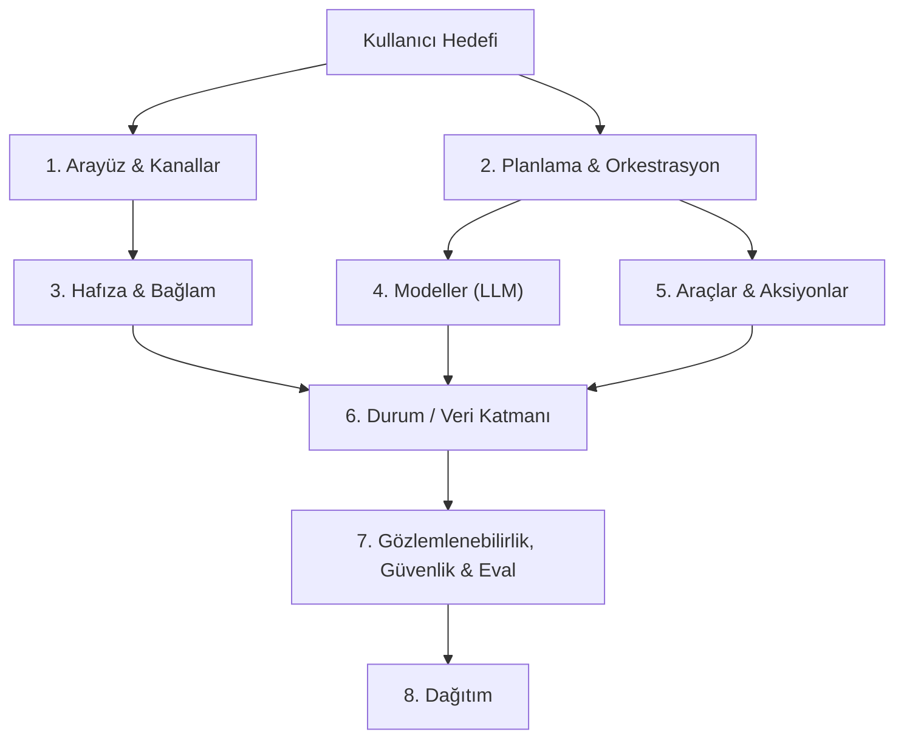

# AI Agent Mimarisi — 8 Katman Haritası

Bu doküman, yaygın kullanılan **8 katmanlı AI Agent Architecture** referans modelini açıklar ve
bu projenin her katmanda neyi nasıl karşıladığını gösterir. Diyagramdaki araçlar çoğunlukla
Python/TypeScript ekosisteminden gelir. Aşağıdaki tablolarda .NET karşılıkları da verilmiştir.

Durum işaretleri: ✅ var · 🟡 kısmen var · ❌ yok

---

## 1. Arayüz & Kanallar

**Ne işe yarar:** Kullanıcının ajana ulaştığı her yüzey. İyi bir mimaride kanal sayısı arttıkça
ajan kodu değişmez. Kanal adaptörü, mesajı ortak bir giriş portuna çevirir.

| Diyagramdaki | .NET karşılığı | Bu projede | Durum |
|---|---|---|---|
| Chat UI | Blazor, React | `CustomerSupportBot.Web` (Blazor WASM, SSE streaming) | ✅ |
| API | ASP.NET Core Minimal API | `/chat`, `/chat/stream` (`ChatEndpoints`) | ✅ |
| Ses | OpenAI Realtime | `RealtimeNativeService` + WebSocket | ✅ |
| Ajanlar arası | A2A protokolü | `A2AAgentCatalog` | ✅ |
| Slack / Teams / WhatsApp | Bot Framework, Slack Events API | — | ❌ |

**Eksik:** Mesajlaşma kanalı yok. Hexagonal yapı sayesinde bir Slack adaptörü yalnızca
`IChatPort`'u çağıran yeni bir inbound adaptör olur. Ajan katmanına dokunmak gerekmez.

## 2. Planlama & Orkestrasyon

**Ne işe yarar:** Hedefi adımlara böler, hangi ajanın veya aracın çalışacağına karar verir,
döngüyü ve sonlandırmayı yönetir.

| Diyagramdaki | .NET karşılığı | Bu projede | Durum |
|---|---|---|---|
| LangGraph | MAF Workflows, Semantic Kernel Process | MAF `GroupChatManager` → `CustomerSupportChatManager` | ✅ |
| CrewAI (rol tabanlı ekip) | MAF çok ajanlı ekip | 6 ajan: Planning, Product, Order, Complaint, Handoff, Response | ✅ |
| Mastra | — | — | — |
| Planlama + yeniden planlama | — | `PlanningAgent`, compound query, replan, paralel SubTask | ✅ |
| Human-in-the-loop | MAF approval | `ApprovalGateService`, onay kuyruğu | ✅ |

**Değerlendirme:** Bu katman projenin en güçlü katmanı.

## 3. Hafıza & Bağlam

**Ne işe yarar:** Ajanın neyi "hatırladığını" ve her LLM çağrısına hangi bağlamın gireceğini belirler.

| Diyagramdaki | Bu projede | Durum |
|---|---|---|
| Kısa süreli hafıza | Oturum geçmişi + `ConversationSummary` (LLM özet) | ✅ |
| Uzun süreli hafıza | Episodik bellek (Qdrant) + `CustomerProfile` | ✅ |
| Vector DB | Qdrant, `text-embedding-3-large` | ✅ |
| Retrieval (RAG) | `SemanticMemoryContextProvider`, KnowledgeBase + Lessons | ✅ |
| Prompt Cache | — | 🟡 |

**Eksik — Prompt Cache:** OpenAI, 1024 token'ı aşan aynı prefix'leri otomatik önbelleğe alır.
Önbellekten gelen input token'lar çok daha ucuzdur. Ancak:

- `TelemetryChatClient` ve `SpendLimitChatClient` yalnızca `InputTokenCount` okuyor.
  `CachedInputTokenCount` hesaba katılmıyor. Bu yüzden **maliyet olduğundan yüksek
  raporlanıyor** ve bütçe limiti erken devreye girebiliyor.
- Önbellek isabet oranı ölçülmüyor. Önbelleği bozan dinamik içeriğin (tarih, profil vb.)
  system prompt'un başında mı sonunda mı durduğu da görünmüyor.

## 4. Modeller (LLM)

**Ne işe yarar:** Akıl yürütme motoru. İyi bir mimari modele değil bir soyutlamaya bağlanır.

| Diyagramdaki | Bu projede | Durum |
|---|---|---|
| GPT | OpenAI / Azure OpenAI (`gpt-5.4`, `gpt-5.4-nano`, realtime) | ✅ |
| Claude / Gemini / Llama | — | ❌ |
| Soyutlama | `Microsoft.Extensions.AI` → `IChatClient` | ✅ |
| Görev başına model | Ana model + reasoning modeli ayrı | ✅ |

**Eksik:** `AiProvider` enum'unda yalnızca `OpenAI` ve `AzureOpenAI` var. `IChatClient`
soyutlaması zaten hazır olduğundan Anthropic, Gemini veya Ollama (yerel Llama) eklemek
yalnızca adaptör ve konfigürasyon işi. Ucuz bir modelin hata verdiğinde başka bir modele
geçmesi (fallback zinciri) de bu katmanda yapılır.

## 5. Araçlar & Aksiyonlar

**Ne işe yarar:** Ajanın dış dünyada okuma ve yazma yapmasını sağlar.

| Diyagramdaki | Bu projede | Durum |
|---|---|---|
| SQL/DB | Sipariş, ürün ve şikayet tool'ları (EF Core / Postgres) | ✅ |
| APIs | E-posta, kargo uçları | ✅ |
| GitHub / Browser / Code | Müşteri destek alanı için gerekli değil | — |
| MCP (Model Context Protocol) | — | ❌ |

**Eksik — MCP:** Tool'lar MAF'a doğrudan kayıtlı. Bunları bir MCP sunucusu olarak dışa
açmak (`ModelContextProtocol` NuGet paketiyle) iki şey sağlar: başka ajanlar ve IDE'ler
(Claude Desktop, Copilot) aynı iş tool'larını kullanabilir, proje de harici MCP
sunucularını tüketebilir.

## 6. Durum / Veri Katmanı

| Diyagramdaki | Bu projede | Durum |
|---|---|---|
| PostgreSQL | EF Core 10, oturum, trace, onay, şikayet | ✅ |
| Redis | Hybrid cache, distributed lock, pub/sub, bütçe sayaçları | ✅ |
| S3 / Storage | Fotoğraflar (veritabanı veya yerel disk) | 🟡 |
| Qdrant | Knowledge, Lessons, Episodic koleksiyonları | ✅ |

**Not:** Çok pod'lu üretim ortamında ek dosyaların S3, MinIO veya Azure Blob gibi bir nesne
deposuna taşınması önerilir.

## 7. Gözlemlenebilirlik, Güvenlik & Eval

| Diyagramdaki | Bu projede | Durum |
|---|---|---|
| Tracing | OpenTelemetry → OTel Collector → Jaeger; MAF `UseOpenTelemetry` (gen_ai semconv) | ✅ |
| Langfuse / Phoenix | — (OTLP hazır, yalnızca exporter eksik) | 🟡 |
| Maliyet | `CostCalculator`, `LlmBudget`, görüşme başına maliyet | ✅ |
| Guardrails (girdi) | `InputGuard`: injection, PII maskeleme, unicode, ID bombası | ✅ |
| Guardrails (çıktı) | `ResponseAgent` self-critique + `ReasoningSanityChecker` | 🟡 |
| RAGAS / TruLens | MEAI LLM-judge (relevance/coherence), YAML senaryolar | 🟡 |
| Replay / debug | Trace Replay UI | ✅ |

**Eksikler:**

- **Langfuse/Phoenix:** Collector'a ikinci bir OTLP exporter eklemek yeterli. Böylece prompt
  ve completion içerikleri LLM'e özel bir arayüzde görünür.
- **Çıktı guardrail'i:** Bot yanıtı müşteriye gitmeden önce deterministik bir çıktı kapısı
  yok. Örneğin başka bir müşterinin e-postası veya telefonu, iç sistem bilgisi ya da
  system prompt sızıntısı yakalanmıyor.
- **RAG metrikleri:** Faithfulness (yanıt bağlama dayanıyor mu?) ve context relevance
  ölçülmüyor. `Microsoft.Extensions.AI.Evaluation.Quality` içindeki `GroundednessEvaluator`
  ve `RetrievalEvaluator`, RAGAS'ın .NET karşılığıdır.

## 8. Dağıtım

| Diyagramdaki | Bu projede | Durum |
|---|---|---|
| Docker | Yalnızca altyapı için `docker-compose` (Postgres, Redis, Qdrant, OTel...) | 🟡 |
| Kubernetes | — | ❌ |
| CI | GitHub Actions + Testcontainers | ✅ |
| AWS / Azure / Cloudflare | — | ❌ |

**Eksik:** API ve Web için `Dockerfile` yok. `dotnet publish /t:PublishContainer` ile
Dockerfile yazmadan imaj üretilebilir. Ardından compose'a uygulama servisleri ve bir
Helm chart ya da k8s manifest'i eklenebilir. Sistem zaten çok pod'a hazır (Redis lock,
pub/sub).

---

## Özet Skor Kartı

| # | Katman | Durum | En değerli sonraki adım |
|---|---|---|---|
| 1 | Arayüz & Kanallar | 🟢 güçlü | Slack/Teams adaptörü |
| 2 | Orkestrasyon | 🟢 çok güçlü | — |
| 3 | Hafıza & Bağlam | 🟢 güçlü | Prompt cache farkındalığı (maliyet doğruluğu) |
| 4 | Modeller | 🟡 tek sağlayıcı | Çok sağlayıcı + fallback |
| 5 | Araçlar | 🟢 alan için yeterli | MCP sunucusu |
| 6 | Durum / Veri | 🟢 güçlü | Nesne deposu (S3/MinIO) |
| 7 | Gözlem, Güvenlik, Eval | 🟡 iyi ama eksikli | Çıktı guardrail'i, Langfuse, RAG metrikleri |
| 8 | Dağıtım | 🟠 zayıf | Uygulama container'ı + k8s |
